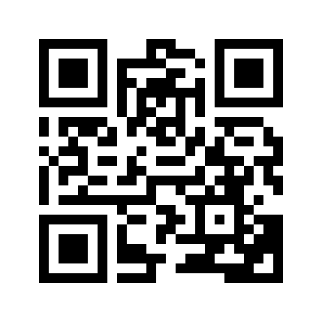

# RAC Vision: control de EPP con cámaras

## 🎬 Video demo

▶️ **[Ver el video demo de RAC Vision](PEGAR_ENLACE_DE_YOUTUBE_AQUI)** · 🌐 Demo en vivo: https://racvision.org



RAC Vision detecta en tiempo real si las personas llevan casco y chaleco, reconoce caras, mide la postura y avisa (panel web, Telegram, MQTT y la caja con ESP32) cuando falta un EPP.

---

## 📂 Estructura

*   **App web (Flask):** `app.py` (detector público y `/predict`), `admin.py` (panel, usuarios, reportes), `data_store.py` (datos y configuración), `templates/`, `static/`.
*   **Motor de detección:** `motor.py`, `helmet_detector.py` (casco), `epp.py` (chaleco), `pose.py` y `cuerpo.py` (postura), `face_detector.py` y `face_id.py` (caras), `riesgo.py`, `salud.py`.
*   **Avisos y hardware:** `aviso_telegram.py`, `aviso_mqtt.py`, `hardware.py`, `firmware/`.
*   **SGEP-Dashboard:** `sgep.py`, `sgep_seed.py`, `sgep_local.py` (corre solo el dashboard en localhost).
*   **Modelos (`modelos_app/`):** `detector_casco.onnx`, `detector_chaleco.onnx`, `detector_pose.onnx` (no está en git, va por scp), los `*_int8.*` de OpenVINO, los dos de caras (`face_*.onnx`) y `modelo.keras` (clasificador viejo, se puede elegir en la configuración).
*   **Entrenamiento y medición (`herramientas/`, se corren desde la raíz, ej. `python herramientas/evaluar_modelos.py`):** `ea.py` y `retrain.py` (modelo Keras), `cuantizar.py`, `evaluar_modelos.py`, `benchmark_inferencia.py`, `benchmark_carga.py`, `convert_model.py`. Los notebooks de Colab están en `entrenamiento/`.
*   **Tests y docs:** `tests/`, `docs/`.

---

## 🚀 Uso

```bash
pip install -r requirements-dev.txt
python -m pytest tests
gunicorn app:app
```
