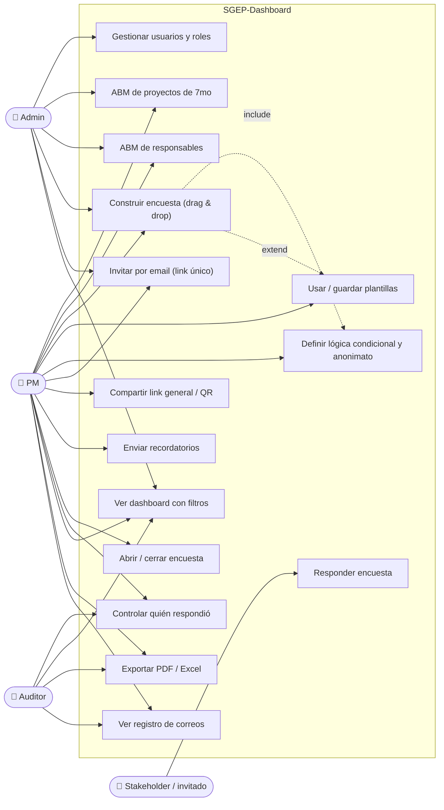
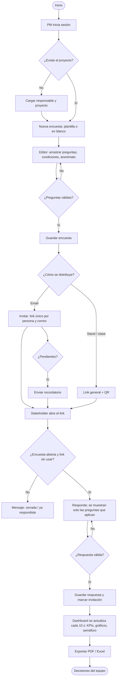
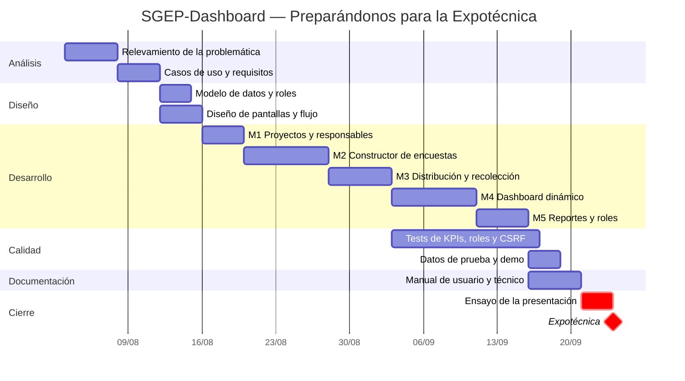

# SGEP-Dashboard — Diagramas

Los diagramas están en Mermaid: GitHub y VS Code (con la extensión de Mermaid) los dibujan directamente; para exportarlos a imagen se puede pegar cada bloque en <https://mermaid.live>.

## Casos de uso

Admin hereda todos los casos de uso del PM (se dibujan solo algunos para no recargar el diagrama).

## Flujo: de la encuesta al dashboard

## Gantt del desarrollo

